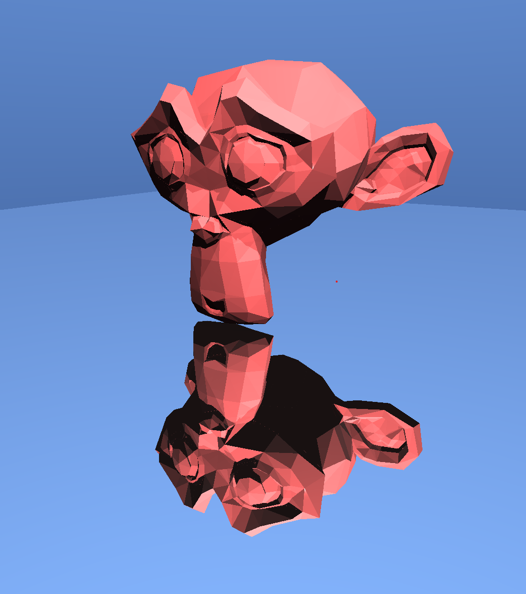

# RayZen

[](LICENSE)

RayZen is a modern, open-source GPU-accelerated path tracer written in C++ and OpenGL. It is designed for real-time physically-based rendering (PBR) of 3D scenes, supporting advanced features such as BVH acceleration, dynamic scene support, SSBO caching, debug overlays, and interactive camera controls. RayZen is ideal for graphics research, education, and as a foundation for your own renderer.



---

## Features

- **Real-Time Path Tracing**: GPU compute path tracing with a fragment-shader fallback.
- **BVH Acceleration**: Fast ray traversal using a Bounding Volume Hierarchy (BLAS/TLAS) for high performance.
- **Dynamic Scene Support**: BVH and SSBOs are rebuilt on-the-fly for moving objects.
- **SSBO Caching**: BVH and triangle data are cached to disk for fast startup.
- **Physically-Based Materials**: Support for metallic, dielectric, rough, and transparent materials.
- **Multiple Light Types**: Point and directional lights.
- **OBJ Mesh Loading**: Import and render standard OBJ meshes.
- **Interactive Camera**: WASD movement and mouse look.
- **Debug Overlays**: Toggle light markers, BVH wireframes, and BLAS/TLAS debug modes.
- **Modular C++ Design**: Clean, extensible codebase.

---

## Getting Started

### Prerequisites
- C++17 compatible compiler
- OpenGL 4.3+
- CMake 3.10+
- [GLFW](https://www.glfw.org/), [GLEW](http://glew.sourceforge.net/), [GLM](https://glm.g-truc.net/), [Assimp](https://www.assimp.org/), libpng

### Quick Install (Linux)
Run the provided script to install all dependencies:

```bash
bash install_requirements.sh
```

### Build Instructions

```bash
git clone https://github.com/PetoAdam/RayZen.git
cd RayZen/RayZen
mkdir build && cd build
cmake ..
make
./RayZen
```

### Windows (MSVC)

Use an x64 Visual Studio Developer PowerShell with the C++ desktop workload,
CMake 3.15 or newer, Ninja, Git, and a current NVIDIA/AMD/Intel OpenGL driver
supporting OpenGL 4.3. Install [vcpkg](https://github.com/microsoft/vcpkg) and
set `$env:VCPKG_ROOT` to its checkout. The checkout needs the manifest's pinned
baseline in its Git history; a shallow checkout may require fetching it.
From the repository's `RayZen` directory:

```powershell
cmake -S . -B build-win -G Ninja `
  "-DCMAKE_TOOLCHAIN_FILE=$env:VCPKG_ROOT/scripts/buildsystems/vcpkg.cmake" `
  -DVCPKG_TARGET_TRIPLET=x64-windows-static `
  -DCMAKE_POLICY_DEFAULT_CMP0091=NEW `
  '-DCMAKE_MSVC_RUNTIME_LIBRARY=MultiThreaded$<$<CONFIG:Debug>:Debug>' `
  -DCMAKE_BUILD_TYPE=Release
cmake --build build-win --parallel
ctest --test-dir build-win --output-on-failure
cd build-win
.\RayZen.exe --prepare-cache
.\RayZen.exe --cache-only
```

vcpkg installs the manifest dependencies during configuration. The static
triplet and matching MSVC runtime above were tested; keep the source tree and
assets available when running the executable. Preparation and cache-only
launches must use the same working directory for the BVH cache.

### Fluid demonstrations

From `RayZen/build`, run either independent GPU particle simulation:

```bash
./RayZen --fluid=2d
./RayZen --fluid=3d
```

Hold the left mouse button to push particles or the right button to pull them.
In 3D the interaction point lies on the world-space `z=0` plane. Space pauses,
R resets, and Escape exits. The 3D demonstration includes a rotating obstacle.

These are original, simplified SPH-inspired simulations, not a Unity shader
port or a reproduction of its simulation and rendering. The 2D view draws
particles; the 3D view deposits particle density into a GPU 3D grid and
raymarches an isosurface with approximate reflection and refraction.
It does not produce a triangle mesh or integrate fluid with RayZen's
ray/path tracing, BVH, shadows, materials, foam, or caustics. Neighbor
evaluation is all-pairs, so cost scales quadratically with particle count;
the demos currently use 340 particles in 2D and 1,000 in 3D. A spatial
neighbor grid and integration with the existing scene ray tracer would be
needed for larger or integrated scenes.

Use `--fluid=3d --benchmark-frames=100` (or `2d`) for a synchronized
800x600 measurement: ten warm-up frames are discarded, then each measured
frame advances two fixed 1/120-second simulation steps and renders. This
measures throughput, not wall-clock simulation speed or startup JIT.
Shader binaries use the normal driver-dependent cache; fluid mode currently
does not support cache preparation or cache-only mode.

### Controls & Debug
- **WASD**: Move camera
- **Mouse Drag (LMB)**: Rotate camera
- **L**: Toggle light debug markers
- **B**: Toggle BVH wireframe debug
- **N**: Toggle BVH debug mode (TLAS/BLAS)
- **F1**: Toggle editor raster mode
- **F2**: Toggle swap interval
- **F3**: Open/close settings; use up/down to select and left/right to adjust
- **Tab**: Switch between render settings and material settings while F3 is open
- **F4**: Save material settings while the material page is open
- **ESC**: Exit

The settings panel shows smoothed FPS and controls shading mode, bounce budget,
accumulation, exposure, tracing and editor ambient light, point and
directional light power, caustics and their photon budget, and the subsurface quality switch. Render settings are
session-only; for persistent settings edit `RayZen/config/render_config.ini`,
which is hot-reloaded. A successful file reload replaces session render settings.
For interactive path tracing without changing that file, launch
`./RayZen --config=../config/realtime.ini` from `RayZen/build`. This preset
uses three bounces and progressive accumulation; it favors responsiveness over
fully converged indirect light, and moving the camera resets the accumulation.
The selected file is hot-reloaded. Performance depends on resolution, scene,
GPU and driver; the first shader JIT is not included in steady-state FPS.
The supplied `render_config.ini` selects **PBR RAY TRACING**. Press F3 and use
left/right on **MODE** to choose path tracing, PBR ray tracing, or Lambertian.
While the raster editor is displayed, **EDITOR PREVIEW** is shown on screen;
it is not the selected traced mode.
Use `--config=../config/caustics.ini` for five-bounce path tracing with refractive
caustics enabled, or toggle **CAUSTICS** in the F3 render page.
Use `--config=../config/realtime-ray.ini` for direct lighting with traced
reflections and refractions, without diffuse indirect paths or caustics.

The material page selects a material by index and edits its base color,
metallic, roughness, reflectivity, transparency, IOR, subsurface distance and
base-color map. Changes affect all objects sharing that material and reset
accumulation. F4 explicitly saves **all** material settings to
`RayZen/config/materials.ini`; they are loaded at startup. Material settings are
not hot-reloaded. Save errors are reported in the log. Texture paths in this
file are absolute references, not embedded assets; missing files cause startup
to fail rather than silently changing the material. Saved materials are keyed
by their scene indices, so changing the scene's material order requires updating
or recreating the saved settings.

Opaque materials use Disney-inspired diffuse and GGX specular shading in the
traced and raster views. Albedo is linear RGB; base-color PNGs are decoded from
sRGB. Metallic mixes between dielectric and colored metal reflection, and
roughness controls the GGX lobe. Dielectric normal-incidence reflectance comes
from IOR; **REFLECTIVITY** boosts that value from 1× to 2× and does not turn a
dielectric into a mirror. Metallic materials use albedo for reflection instead.
This changes the appearance of previously saved nonzero reflectivity settings;
the material file format remains unchanged.

`shading_mode` accepts:
- `path_tracing` (default): stochastic PBR paths with the configured bounce budget
  (default five). This is the generated configuration default; the supplied
  `render_config.ini` selects `ray_tracing`.
- `ray_tracing`: direct PBR lighting and shadows plus up to four surface
  interactions for traced GGX reflections and dielectric reflection/refraction.
  It omits diffuse indirect bounces and subsurface scattering; rough reflections
  are stochastic and converge with accumulation on the compute backend.
- `lambertian`: one primary ray plus shadow rays and diffuse direct lighting;
  primary surfaces are diffuse, specular/refraction are ignored, and transparent
  shadow filtering remains approximate.

The bounce budget applies only to path tracing. Exposure is a display adjustment;
changes to mode, bounces or accumulation reset the accumulated samples. Temporal
accumulation currently works only in the compute backend; the fragment backend
renders each sample directly.

For a reproducible, conservative throughput measurement, run
`./RayZen --benchmark-frames=100 --swap-interval=0` from the build directory.
The benchmark starts in tracing mode, skips ten warm-up frames, synchronizes
the GPU each frame and exits after reporting average frame time and FPS. This
serializes CPU/GPU work, so it is not identical to normal pipelined frame rate.
Report the GPU, driver, resolution, scene, shading mode and bounce budget when
comparing results.

On the WSL D3D12 OpenGL driver, normal startup displays the raster editor while
the compute shader is prewarmed in a background context, then automatically
switches to the selected tracing mode. Press F1 during warmup to stay in the
editor, or press it again to enable the automatic switch. This hides the wait
but does not shorten driver JIT compilation. `--path-tracer-only`, including
benchmark mode, instead waits for tracing immediately. Driver program binaries
and pipeline caches are driver-dependent and are not available on every GPU.
The compute backend compiles separate programs for path tracing, PBR ray tracing,
and Lambertian shading. It initially loads only the selected mode and keeps other
programs in memory after first use. Switching to an unprepared mode may pause
while its shader compiles and the driver performs first-use JIT. Compile and
link timings are logged separately; first-frame timings also include driver JIT.

For WSL/Linux, `--keep-warm` offers a process-lifetime workaround for repeated
JIT: closing the window hides it while the renderer and compiled GPU resources
remain alive. From the build directory, keep the terminal session running:

```bash
GALLIUM_DRIVER=d3d12 ./RayZen --keep-warm --require-hardware-renderer &
# After closing the window:
./RayZen --restore-warm
# To terminate the retained process:
./RayZen --quit-warm
```

Only one warm instance per Linux user is supported. Hidden rendering is paused,
but the process and GPU resources still use memory. The initial JIT still
occurs, and a different shading mode may need its own first-use JIT. Exiting
with ESC, stopping the process, restarting WSL, or losing the terminal session
can destroy the in-memory state; this is not a persistent disk cache.
Source or shader changes require a fresh process and may trigger JIT again.
Restore and quit commands enqueue requests; if the renderer is still compiling,
it processes them once it becomes responsive.

### Preparing shader and BVH caches

After building, run these commands from the same working directory:

```bash
./RayZen --prepare-cache
./RayZen --cache-only
```

`--prepare-cache` opens a hidden OpenGL context, builds the demo scene's BLAS
and TLAS, compiles all three compute shading modes and the other shader programs,
writes their caches, and exits.
It requires a working OpenGL display/context and a driver that supports program
binaries. The existing Microsoft/D3D12 OpenGL translation path disables shader
binary caching, so preparation fails explicitly there. Use
`--allow-software-renderer` when intentionally testing with a software driver.

`--cache-only` loads compatible caches or fails rather than compiling shaders
or building BVHs at startup. Normal launches automatically use valid caches and
otherwise compile/rebuild them. Changing a shader, mesh, material index, object
transform, or driver invalidates the relevant cache. Shader source and scene
assets must remain available for validation; this is not a source-free asset
package. The shader binaries are driver/GPU-specific and the driver may still
perform additional JIT compilation. Run preparation again after changing the
driver, scene, or shaders. Dynamic object movement during rendering still
rebuilds the TLAS.

Shader sources support `#include "file.glsl"` on its own line, relative to the
including file. Included source participates in the cache hash; missing or
recursive includes fail explicitly. compute and fragment tracing share `direct_lighting.glsl`,
`material_sampling.glsl`, `pbr.glsl` and `ray_tracing.glsl`.

For independent preparation or loading, use `--prepare-shaders` or
`--prepare-bvh`, followed by `--shader-cache-only` or `--bvh-cache-only`
respectively. This allows BVH caching even when shader binaries are unavailable
on the active driver. All preparation modes currently require an OpenGL context.

On a driver that supports program binaries, `./RayZen --prepare-shaders`
prepares them and `./RayZen --shader-cache-only` requires them at startup.
This avoids recompiling GLSL but does not guarantee that the driver skips its
own first-dispatch compilation. On the tested WSL D3D12 RTX 4070 SUPER driver,
OpenGL reports zero binary formats, so these shader-only commands cannot provide
a persistent compiled shader. An isolated Mesa disk-cache experiment produced
no entries and both cold and repeat ray-tracing launches spent about 25 seconds
on their first frame. Results can differ with other drivers; do not assume that
preparing a cache on another GPU or driver will make it portable.

On native Windows with an RTX 4070 SUPER and NVIDIA OpenGL 4.6 driver 591.86,
the PBR ray-tracing shader linked in about 2.2 seconds on an initial launch
without RayZen shader caches. After preparation, a fresh `--cache-only`
process loaded its program binary and BVH caches, with a 54 ms first frame
versus 148 ms on the initial launch. These frame timings exclude initialization;
the driver cache state was not fully controlled. A separate 100-frame
synchronized benchmark averaged 29.9 FPS with the demo scene and an 800x600
window. These figures are not guarantees for other systems.

Shader caches are in `RayZen/shaders/cache/`; BVH caches are in
`bvh_cache/v4/` relative to the process working directory. BVH files use the
current C++ data layout and are not a portable interchange format. Avoid
concurrent cache preparation in the same working directory.

### Moving and changing objects

Changing a game object's affine, invertible transform keeps its mesh-local BLAS,
rebuilds the world-space TLAS, uploads the instance transforms and clears the
accumulation history. Adding/removing objects or editing mesh triangles rebuilds
the affected scene buffers and raster geometry; empty scenes are supported.
Those runtime changes do not overwrite the prepared startup cache. Invalid
transforms and material indices stop rendering with an error.

The current implementation fingerprints mesh triangles each frame to detect
in-place edits and stores a separate BLAS per object, even for shared meshes.
For large or deforming scenes this is expensive; revision-based dirty tracking,
shared BLAS instances and refitting are future optimizations. TLAS refitting
updates bounds without rebuilding topology and is often faster for small
movements, but its traversal quality can deteriorate; production systems
typically rebuild when refit quality becomes poor or the instance set changes.

`path_tracer_bounce_budget` accepts 1–100; large values can be very slow. The
opaque path uses a diffuse/GGX sampling mixture and evaluates direct lighting at
each bounce. Glass uses dielectric Fresnel reflection, total internal reflection,
and distance-dependent absorption: its albedo and transparency describe
transmittance per world unit. Path tracing needs enough bounces to enter and exit
a closed mesh; ray-tracing mode uses a fixed four-interaction limit. The demo uses a closed glass cube instead of the
open monkey mesh. Closed, consistently wound meshes give more reliable results.
Direct shadow rays use the same per-world-unit glass absorption, including the
base-color texture sampled at entry, and approximate Fresnel transmission at
each boundary. Without caustics they remain straight, so shadow shapes are not
refracted; boundary Fresnel uses an exterior-incidence approximation. Closed,
consistently wound meshes are required.
Shadow traversal supports up to eight overlapping glass volumes and 32
interfaces; rays exceeding either limit are treated as blocked. Surface normals
are flat, and ambient lighting and radiance clamping remain approximations, so
this is not an unbiased reference path tracer.

### Refractive caustics

The optional compute-only caustics pass traces photons from point and
directional lights through glass using refraction, Fresnel transmission and
colored absorption. It projects visible photon hits onto primary opaque
surfaces and progressively accumulates them with the path tracer. For primary
opaque surfaces it replaces the straight-through glass shadow approximation,
avoiding counting that approximation and the photons as the same light path.
Turn it on with `caustics_enabled=true` or the F3 **CAUSTICS** switch.

This is a noisy, screen-space photon estimate, not a reference bidirectional
path tracer: it uses a configurable photon budget and a 3×3 pixel reconstruction
filter, which can blur or leak across nearby edges. Accumulation reduces noise
while the view is still; camera or scene changes reset it. It traces one closed,
consistently wound glass instance per photon, up to eight boundaries; nested or
intersecting glass, lights inside glass, reflective caustics, secondary camera
bounces and subsurface scattering are not supported. Other glass between a
directional light and the sampled object is treated as an occluder. The
fragment backend cannot use this pass. Its cost and first-use shader JIT can be
substantial; use the real-time preset or disable the switch when responsiveness
matters more than caustics. The default is 65,536 photons per glass object per
light per frame (previously 262,144). Change **PHOTONS** in the F3 panel or set
`caustic_photon_count` from 1,024 to 262,144. Lower values run faster but are
noisier and need more accumulated frames; moving the camera resets accumulation.

### Subsurface scattering

The implementation is an opt-in homogeneous, isotropic random
walk per material. A positive mean free path (in world units) enables it, while
zero retains the existing opaque material. The material's albedo is the
scattering color and its IOR controls the dielectric boundary. Paths sample
free-flight distances inside the hit instance, scatter or exit through the
boundary, and use the existing bounce budget and accumulation. Direct light
at scattering events is approximated with a straight shadow ray through the
exit, with medium attenuation and Fresnel transmission.

Enable **SSS MASTER** on the render page, or add `subsurface_enabled=true` to
the render config. On the material page, set **SSS DISTANCE** to a positive
value for the selected material; zero makes it opaque when not otherwise
transparent. Both the master switch and a positive material distance are
required. The demo's wax-colored cube uses material 5 with distance 0.35;
the blue monkey remains plastic. The optional final `Material` constructor
argument also sets this distance.

The CPU and both GLSL material layouts must stay identical; shader source
changes invalidate program caches, while BVH caches do not contain materials.
Both tracing backends share the transport functions. The initial model does not
handle nested/intersecting volumes,
cameras inside volumes, anisotropic scattering, spatially varying volume
coefficients or refraction of direct-light shadow rays. A base-color map on
an SSS material is sampled at entry and stays constant along that walk.
Raster, direct-ray and Lambertian
previews cannot show the random walk.

### Material textures

The built-in checker is base map 0 and is assigned to the demo floor. To make
PNG images available in the material page, launch with one or more options:

```bash
./RayZen --texture=/absolute/path/to/albedo.png
```

The log lists each image's map index. Select the material on the F3 material
page, choose **BASE MAP**, and press F4 to save the assignment. Saved PNG
references are loaded automatically on later launches; the original file must
remain available. Base-color RGB is decoded from sRGB and multiplied by the
material color. PNG alpha is currently ignored. OBJ UVs are interpolated in
both tracing backends and the raster preview; faces without UVs use the scalar
base color. UVs repeat outside 0–1.

Textures are packed into an OpenGL 4.3 texture array. Images are nearest-neighbor
resampled to the largest width and height in the array, with nearest filtering,
no mipmaps and a 256 MiB array budget. Inputs are limited to 4096 pixels per
dimension and GPU limits also apply. Roughness, metallic and normal maps,
smooth vertex normals, mipmapping and ray-appropriate LOD remain future work.

---

## Project Structure

- `src/` — C++ source files
- `include/` — C++ headers
- `shaders/` — GLSL shaders
- `meshes/` — Example OBJ meshes
- `docs/` — Documentation

---

## Documentation

- **User & Build Guide**: See this README.
- **Technical & Mathematical Details**: See [`docs/TECHNICAL_DETAILS.md`](docs/TECHNICAL_DETAILS.md) for an in-depth explanation of the rendering algorithms, BVH, and system architecture.

---

## Contributing

Contributions are welcome! Please open issues or pull requests for bug fixes, new features, or improvements.

---

## License

This project is licensed under the MIT License. See the [LICENSE](LICENSE) file for details.
